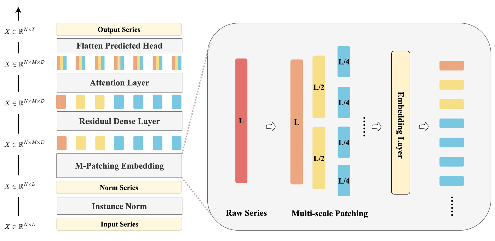

# CSformer

**Cross-Scale Attention for Long-term Time Series Forecasting**

Liangjian Wen, Quan Hu, Cong Guo, Ao Hu, Mingyi Zhang<br>
*IEEE Signal Processing Letters*, 2024

[Paper](https://doi.org/10.1109/LSP.2024.3439103) · [Reproduction records](docs/reproduction.md) · [Citation](#citation)

Official PyTorch implementation of CSformer, a channel-independent model for long-term time
series forecasting.

## Overview

Time series often contain noise and jitter, with limited useful information in small, fixed-length
patches. CSformer represents each variable at multiple temporal scales and learns relationships
across those scales, bringing local and global patterns into a compact attention model.

- **Multi-scale patching:** begin with the whole input sequence, then split it into halves,
  quarters, and finer scales. Each patch is embedded into a shared feature dimension.
- **Cross-scale interaction:** a residual dense block extracts patch features, followed by a
  single-head attention layer that connects the resulting tokens across scales.
- **Compact forecasting:** a flattening head maps the tokens to future values. Three scales
  produce only seven tokens per variable, reducing the number of tokens needed for attention.

## Architecture



*Figure 1 from the paper, with the patching label spelling corrected. The left panel shows the
forecasting pipeline; the right panel shows multi-scale patch embedding.
[Editable draw.io source](assets/csformer-architecture.drawio).*

The model applies reversible instance normalization per channel, multi-scale patch embedding,
a residual dense layer, one attention layer, and a forecast head. With `s` scales, each variable
has `2^s - 1` tokens. The paper uses input length 336 and scale counts of 4 for Weather, 2 for
ETTm1/ETTm2, and 3 for the other datasets.

## Main Results

**Paper-reported accuracy (Table I).** MSE below is averaged over prediction lengths
96, 192, 336, and 720; lower is better. Bold marks the lowest displayed mean, including ties
at three decimal places. Baseline values are those reported in the paper.

| Dataset | **CSformer** | PatchTST | DLinear | iTransformer | FITS |
|---|---:|---:|---:|---:|---:|
| Weather | **0.229** | 0.230 | 0.246 | 0.258 | 0.248 |
| Traffic | **0.393** | 0.396 | 0.434 | 0.428 | 0.433 |
| Electricity | **0.162** | **0.162** | 0.166 | 0.178 | 0.169 |
| ETTh1 | 0.419 | 0.423 | 0.432 | 0.454 | **0.408** |
| ETTh2 | 0.341 | 0.349 | 0.431 | 0.383 | **0.337** |
| ETTm1 | **0.351** | 0.352 | 0.357 | 0.407 | 0.360 |
| ETTm2 | 0.259 | 0.258 | 0.267 | 0.288 | **0.256** |

The four values behind each mean are available in
[metadata/paper-comparison.json](metadata/paper-comparison.json); the paper contains the full
per-horizon MSE and MAE comparison.

**Paper-reported efficiency (Table II).** On Traffic, CSformer has an inference latency of
**1.085 ms**, compared with **12.971 ms** for PatchTST, approximately a 12× speedup under the
paper's benchmark settings.

## Getting Started

### Installation

The recorded GPU experiments use **Python 3.10, PyTorch 2.6.0, CUDA 12.4, and an NVIDIA A100**:

```bash
python3.10 -m venv .venv
source .venv/bin/activate
pip install --index-url https://download.pytorch.org/whl/cu124 torch==2.6.0
pip install -r requirements-cu124.txt
```

For CPU use, install `pip install -r requirements.txt`. Exact GPU and tested macOS CPU package
versions are recorded in `requirements-cu124.lock.txt` and `requirements-cpu-macos.lock.txt`;
see [environment details](docs/reproduction.md#setup).

### Dataset Preparation

Download `all_six_datasets.zip` from the
[Autoformer dataset folder](https://drive.google.com/drive/folders/1ZOYpTUa82_jCcxIdTmyr0LXQfvaM9vIy)
and arrange the seven CSVs as follows:

```text
dataset/
├── ETT/{ETTh1,ETTh2,ETTm1,ETTm2}.csv
├── weather/weather.csv
├── electricity/electricity.csv
└── traffic/traffic.csv
```

Data sources and SHA-256 checksums are in
[metadata/dataset-sources.json](metadata/dataset-sources.json). The scaler is fitted on the
training split only; split definitions are in [the reproduction notes](docs/reproduction.md#data-and-configurations).

### Training and Evaluation

Train CSformer on ETTh1 with input length 336 and prediction length 96:

```bash
CUDA_VISIBLE_DEVICES=0 python run.py \
  --model CSformer --data ETTh1 --model_id ETTh1_336_96 \
  --root_path ./dataset/ETT/ --data_path ETTh1.csv \
  --features M --seq_len 336 --label_len 48 --pred_len 96 \
  --enc_in 7 --e_layers 1 --n_heads 1 --d_model 32 --d_ff 128 \
  --dropout 0.99 --head_dropout 0.15 --top_k 3 \
  --period_list 336 168 84 --batch_size 256 --learning_rate 0.001 \
  --train_epochs 100 --patience 20 --random_seed 2024 --val_protocol legacy
```

Use `--use_gpu 0` to run on CPU. Training selects the checkpoint by validation MSE and runs the
final test after training. To evaluate an existing checkpoint, repeat the same command with
`--is_training 0`.

Checkpoints are saved to `checkpoints/<setting>/checkpoint.pth`, with test metrics and predictions
in `results/<setting>/`. Repeating identical arguments reuses these paths and script logs;
preserve earlier outputs before rerunning.

## Reproduction

Seven launchers in `scripts/CSformer/` each run the four paper horizons. For example:

```bash
bash scripts/CSformer/weather.sh
```

For all 28 configurations from a clean Git checkout, the recorded runner also saves commands,
package versions, dataset hashes and metrics:

```bash
python tools/run_reproduction.py \
  --datasets ETTh1 ETTh2 ETTm1 ETTm2 Weather Traffic Electricity \
  --horizons 96 192 336 720 \
  --data-root /path/to/datasets --output /path/to/new-run-directory --device cuda
```

A single-seed A100 run (seed 2024) completed all **28/28 configurations**. The largest MSE gaps to
the paper are ETTh1-720 (+0.008, +1.80%) and ETTm2-720 (+0.004, +1.16%); they remain unresolved.
The [reproduction notes](docs/reproduction.md) contain the full MSE/MAE results, configurations,
implementation records, pipeline checks, and deviation analysis. These rerun results are separate
from the paper-reported baseline table above; multi-seed statistics and a rerun of the paper's
efficiency benchmark are not included.

The launchers use the recorded `legacy` validation protocol. For new experiments, use
`--val_protocol full` to evaluate every validation window in a fixed order;
[protocol details](docs/reproduction.md#validation-protocol) explain the difference.

Run the test suite with `python -m unittest discover -s tests -v`. An optional end-to-end check
is available as `python tools/smoke_test.py --output /tmp/csformer-smoke`.

## Citation

```bibtex
@article{wen2024crossscale,
  title={Cross-Scale Attention for Long-term Time Series Forecasting},
  author={Wen, Liangjian and Hu, Quan and Guo, Cong and Hu, Ao and Zhang, Mingyi},
  journal={IEEE Signal Processing Letters},
  year={2024},
  doi={10.1109/LSP.2024.3439103}
}
```

## Acknowledgements and License

The training framework and baseline code build on [PatchTST](https://github.com/yuqinie98/PatchTST).
Instance normalization uses [RevIN](https://github.com/ts-kim/RevIN). We thank their authors for
making the implementations available.

CSformer is released under [Apache-2.0](LICENSE). Third-party components retain their original
licenses; see [THIRD_PARTY.md](THIRD_PARTY.md) and [licenses/](licenses/).
